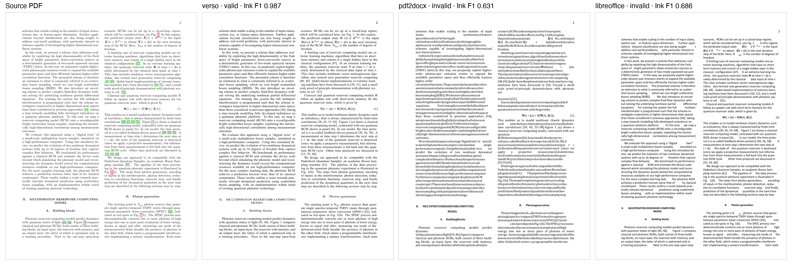
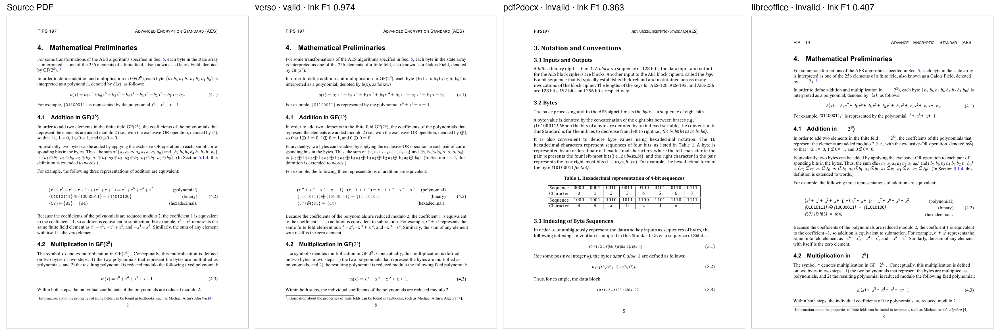
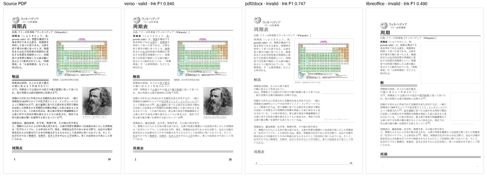
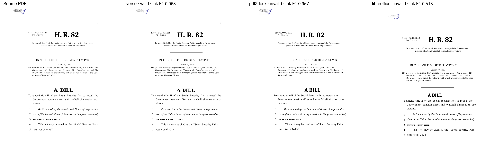
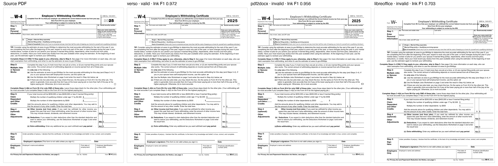
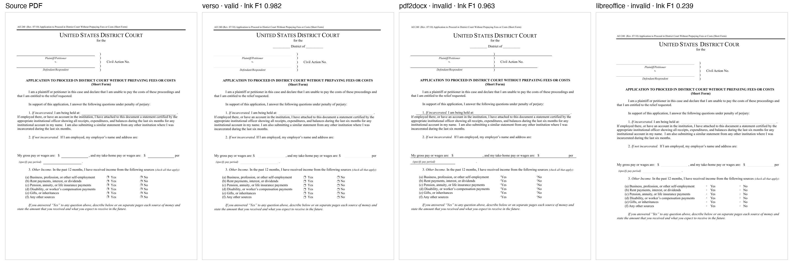

# verso

Convert a PDF into a Word document you can edit, redline and send back, and
that Microsoft's own validator accepts.

```sh
npm install -g @2018kguo/recto@0.10.0  # PDF engine (WebAssembly, no native deps); Node 24+
go install github.com/2018kguo/verso/cmd/verso@latest
verso report.pdf report.docx          # prints a JSON report; exits 1 if it refuses
```

verso finds Recto through `$VERSO_RECTO_MODULE`, a `node_modules` above the
`verso` binary, or the global npm root. It never looks in the working
directory, so converting a file inside an untrusted folder can't load code
planted there.

## Demo

Six public PDFs chosen to be hard:
- a two-column physics paper set in TeX, with math;
- a Japanese Wikipedia article with a periodic table;
- a congressional bill with line numbers;
- NIST's AES standard, with matrices, subscripts and figures made of ruled grids;
- the IRS W-4;
- a federal court form.

Each converter turned each PDF into `.docx`, and Microsoft Word rendered the
result. Ink F1 covers every page of the document. A page count that differs
from the source means text flowed onto the wrong pages.

| | verso | pdf2docx 0.5.13 | LibreOffice 26.2 |
|---|---|---|---|
| Physics paper, 17 pp | **valid**, Ink F1 **0.987** | invalid, 0.631, 18 pp | invalid, 0.686 |
| Japanese Wikipedia, 14 pp | **valid**, **0.947** | invalid, 0.747, 15 pp | invalid, 0.490 |
| H.R. 82 bill, 3 pp | **valid**, **0.968** | invalid, 0.957 | invalid, 0.518 |
| NIST FIPS 197 (AES), 46 pp | **valid**, **0.974** | invalid, 0.363, 54 pp | invalid, 0.407 |
| IRS Form W-4, 4 pp | **valid**, **0.972** | invalid, 0.956 | invalid, 0.703 |
| U.S. Courts AO 240, 2 pp | **valid**, **0.982** | invalid, 0.963 | invalid, 0.239 |

Each image shows one page: the source PDF, then verso, pdf2docx and LibreOffice.








Known gap, visible above: text set in a font Word lacks is drawn in a
substitute fitted to the source width, so its letterforms differ from the
source.

`demo/run.sh` downloads the sources, checks their hashes and rebuilds the
images and `demo/results.tsv`. The PDFs are not in this repository.

The images reproduce pages of their sources, under the sources' terms:
- the physics paper is Schade et al., arXiv:2611.18510, CC BY 4.0;
- the Wikipedia page is from Japanese Wikipedia's 周期表 article, CC BY-SA 4.0;
  `demo/wikipedia-ja.png` is shared under the same license;
- the other four are U.S. government works in the public domain.

`demo/sources.tsv` lists each URL.

## Why

The common open-source converters produce `.docx` files that Word opens but
Microsoft's Open XML SDK rejects. On the 22-document benchmark below, every
output from pdf2docx and from LibreOffice failed validation. A file that fails
validation can open fine on one machine and break in a tracked-changes
workflow, a document-assembly tool or SharePoint. Most people then fall back
to re-typing the text, and lose the layout.

verso is built for one job: taking a PDF someone sent you and returning an
editable Word file that looks like the PDF. That means:

- **Valid or nothing.** With `--validate`, a file is published only after the
  Open XML SDK accepts it and its bytes are unchanged since validation.
- **Editable, not positioned.** Lines a PDF wrapped are reflowed into real Word
  paragraphs, list items keep their hanging indent, and ruled grids become Word
  tables. Absolutely positioned text boxes are a last resort, for text that
  overlaps a table or another column.
- **Honest about what it can't do.** Rotated text, vector art and scanned
  pages are kept as images, and each one is named in the report. A conversion
  with fidelity warnings is refused unless you ask for a review copy
  (`--allow-warnings`).

## Benchmarks

The scores are measured against real Word renders. Each source `.docx` was
exported to PDF by Microsoft Word for Mac; each converter turned that PDF back
into `.docx`; and Word rendered the result again. Scores compare the round
trip with the source. All runs used the same machine, and medians are wall
clock (the three converters ran in one session, sharing the machine with
Word's renders).

Round trip of 22 Word documents (contracts, statements of work, reports):

| Converter | Valid OOXML | Text recall | Ink F1 | ¶ recall | Pages | Median |
|---|---|---|---|---|---|---|
| **verso** | **20/20** (2 RTL refused) | **1.000** | **0.994** | **0.863** | 20/20 | **592 ms** |
| pdf2docx 0.5.13 | 0/22 | 0.943 | 0.689 | 0.623 | 19/22 | 944 ms |
| LibreOffice 26.2 (`soffice --convert-to docx`) | 0/22 | 0.924 | 0.350 | 0.331 | 22/22 | 2824 ms |

21 public business and legal PDFs (loan agreements, deeds, FDA forms,
signature packets) with no source `.docx`. They are scored against the PDF's
own render:

| Converter | Valid OOXML | Text recall | Ink F1 | Pages | Median |
|---|---|---|---|---|---|
| **verso** | **21/21** | 0.996 | **0.984** | **21/21** | **419 ms** |
| pdf2docx 0.5.13 | 0/20 (1 failed) | 0.997 | 0.610 | 16/21 | 2509 ms |
| LibreOffice | 0/21 | 1.000 | 0.177 | 21/21 | 3900 ms |

- **Text recall**: share of the source's words found in the rendered output.
- **Ink F1**: pixel overlap between page renders. It measures whether the
  page looks the same.
- **¶ recall**: share of the source's paragraphs that come back as one Word
  paragraph with the same text. It measures whether the text is editable as
  prose or broken into line fragments.
- **Pages**: documents whose round trip has the source's page count.

Robustness was tested on 300 PDFs sampled from a public corpus of real-world
files (forms, filings, scans, slide decks, CJK, broken producers). 273
convert and validate, in 301 s for all 300 (p95 2.9 s). The other 27 are
refused with a reason: 23 are
entirely scanned (OCR is out of scope), 2 contain right-to-left text, and 2
are password-protected. There were no crashes and no invalid output.

Reproduce with the harness in `bench/`. The Word renderer needs macOS and
Microsoft Word; the default renderer uses LibreOffice and Poppler.

```sh
go build -o verso ./cmd/verso && go build -o verso-bench ./bench
./verso-bench run --converter ./verso --corpus pdfs/ --truth docx/ --renderer word \
  --validator-dll validator/bin/Release/net8.0/verso-validate.dll --out /tmp/verso-run
```

## How it works

1. **Decode.** [Recto](https://github.com/2018kguo/recto) (Rust → WebAssembly)
   reads the PDF in a Node subprocess with a deadline and memory bound. It
   reports glyphs with positions, fonts, colours and links, plus path and
   image boxes. Fonts that map to no text, encrypted files, all-scan
   documents and right-to-left text are refused with a reason.
2. **Lines and spans.** Glyphs with the same style join a span while one
   average tracking value keeps each glyph near its source position. Spans on
   one baseline make a line; raised small text folds in as a superscript.
3. **Tables.** Ruled segments form grids, and text is assigned to cells by
   position. A grid that is ambiguous or too fine stays as text.
4. **Blocks and paragraphs.** Lines group into columns. A new paragraph starts
   when:
   - the gap above a line is wider than its neighbours' gaps;
   - the size changes;
   - a list marker starts the line;
   - the previous line ended early, i.e. the next line's first word would
     have fit on it.

   Alignment, first-line indent and hanging indent are then measured from the
   lines.
5. **Write.** Every page becomes its own Word section with the PDF's page
   size. Paragraph spacing comes from absolute positions, so errors
   don't accumulate down the page. PostScript font names map to their family
   names, and `fontTable.xml` names an Office substitute for fonts Word lacks.
   Each run is fitted to its source width in the face Word will draw it in
   (character scale plus tracking), so lines break where the PDF's did.
   `metrics_gen.go` holds advance widths for that, read by `gen_metrics.go`
   from the LibreOffice fonts (Liberation, Carlito, Caladea) and from
   Word's bundled Verdana; only the numbers are committed, no font files.
   Pages taller than 22 inches are scaled to fit. Lines that repeat in the
   top or bottom margin on three or more pages become a Word header or
   footer, a counting page number becomes a `PAGE` field.
6. **Validate.** Optionally, run the [Open XML SDK](https://github.com/dotnet/Open-XML-SDK)
   validator (`validator/`, .NET 8). The output is written only if the SDK
   accepts it.

The output does not include bidirectional text, form fields, or comments for
PDF annotations. Each of these produces a
warning or a refusal; none is dropped silently.

## Library

```go
report, err := verso.Convert(ctx, "in.pdf", "out.docx", verso.Options{
	Validate: verso.Validator("dotnet", "validator/bin/Release/net8.0/verso-validate.dll"),
})
// report.Validated is true only when the validator ran and accepted the file.
```

`Options` bounds input bytes, pages and time. The Node child gets a V8 heap
cap and is killed when the deadline passes. WebAssembly memory sits outside
the V8 heap, so run verso under a container or ulimit memory bound when the
input is untrusted.

## Testing

```sh
npm ci && dotnet build validator/Validate.csproj -c Release
VERSO_REQUIRE_INTEGRATION=1 go test -race ./...
go test -run '^$' -fuzz FuzzPageModel -fuzztime 60s .
```

The integration tests convert generated PDFs and validate the output. They
cover wrapped sentences, rotated pages, tracking, horizontal scaling, nudged
glyphs, backdrops, tables, links and a 100-page stress document. Where
LibreOffice and Poppler are installed, they also compare render geometry. The
fuzzer feeds arbitrary page models to the layout code and the Word writer, and
checks that the output is well-formed.

## Prior art

These projects were read for ideas; no code was copied:

- [pdf2docx](https://github.com/ArtifexSoftware/pdf2docx) (MIT): line,
  paragraph and table reconstruction.
- [pdfminer.six](https://github.com/pdfminer/pdfminer.six) (MIT): layout
  analysis.
- [pdfplumber](https://github.com/jsvine/pdfplumber),
  [Camelot](https://github.com/camelot-dev/camelot) and
  [Tabula](https://github.com/tabulapdf/tabula-java) (MIT): ruled-table
  detection.
- [LibreOffice](https://www.libreoffice.org/) pdfimport (MPL-2.0).
- [opendataloader-pdf](https://github.com/opendataloader-project/opendataloader-pdf)
  (Apache-2.0): XY-cut reading order.

## License

MIT
